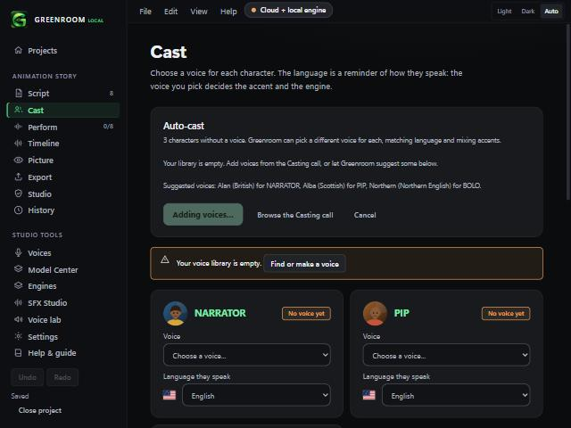
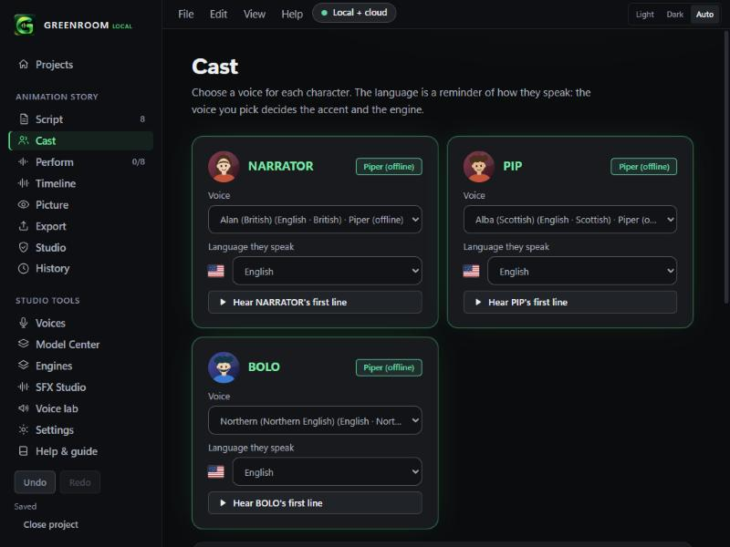
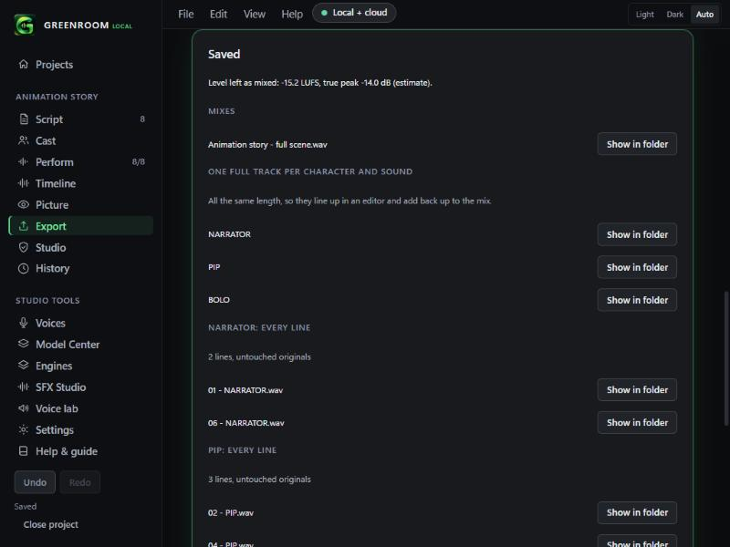

# Auto-cast and per-character export (v0.2.6)

## Do characters create themselves?
Yes. Greenroom reads `NAME: line` from your script and creates a character for every speaker. You then give each one a voice on the **Cast** screen. Auto-cast does that step for you.

## Auto-cast (Cast screen)
When characters have no voice, an **Auto-cast** panel appears.

- It proposes a **different voice for each character**, preferring the character's language, mixing accents, and preferring free local voices.
- Names like Narrator, Announcer, Host or Instructor get narration voices first.
- **Existing choices are never changed.** Nothing is applied until you press Apply, and Undo works afterwards.
- It never guesses gender from a name.
- If your library has fewer voices than characters, it suggests voices from the Casting call. One button downloads them (one confirmation sheet, with sizes) and casts everyone. Or choose "Cast with my library only" and some characters share a voice.

## Saved audio by character (Export screen)
The **Saved** list is grouped, so each character's audio is easy to find:

- **Mixes**
- **One full track per character and sound** (tick *Stems*): the same length, so they line up and add back up to the mix.
- **A group per character** (tick *Every line as its own file*): that character's lines, untouched originals.
- **Cue sheets, editor files and records**

If you export lines but not Stems, a hint explains how to get full-length tracks per character.

## Checked
Unit tests: distinct voices, no change to existing choices, language matching, narration first, accent variety, reuse only when the library is too small, no duplicate suggestions, an empty library, determinism (9 tests); export grouping, counts, ordering, stems hint, forward slashes (6 tests). In the browser demo: three characters were cast with British, Scottish and Northern English voices, and an export with Stems produced the grouped list.

## Not checked
- How the accents sound together, and whether the narration voices suit a given story. Only listening can say.
- Auto-cast with real cloud voices (ElevenLabs, VoiceKiller): the scoring uses each voice's recorded language, accent and notes, which cloud voices fill in less reliably.
- Real exports through the installed app's file dialog.
