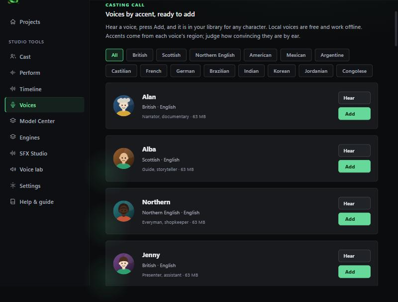
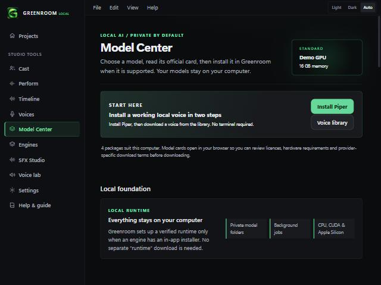
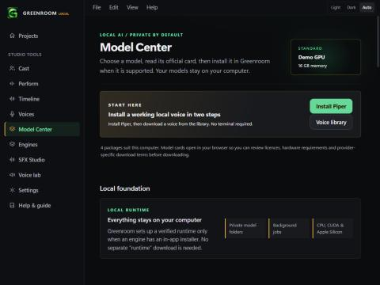

# Casting call and colour options (v0.2.1)

## Casting call (Voices, third tab)
Voices grouped by accent that go into your library in one step, so any character in any scene can use them.

- **24 local voices** (Piper, free, offline) across British, Scottish, Northern English, American, Mexican, Argentine, Castilian, French, German, Brazilian, Indian, Korean, Jordanian and Congolese accents. Press **Hear** to preview, **Add** to download (about 63 MB each, 114 MB for high quality) and add. Greenroom installs the small Piper engine first if it is missing, after one confirmation sheet.
- **Nigerian languages (WazobiaVoice).** After the Model Center setup, pick Nigerian English, Yoruba, Hausa or Igbo and add any of the 13 voices. Before setup, a button takes you there.
- **12 design recipes** for ElevenLabs Voice Design (paid): Lagos market trader, Yoruba elder, Naija teenager, London detective, Southern sheriff, Irish storyteller, Kingston radio host, Indian professor, Outback ranger, whispering villain, curious child, gentle AI assistant. **Open in Design** fills the description and a test line. Nothing is spent until you press generate.

### What was checked
- All 24 Piper voice keys were looked up in the public rhasspy/piper-voices catalogue on 2026-11-02 and exist (single speaker, sizes as listed).
- Unit tests check key format, uniqueness, 12+ accents, 52 Wazobia entries and recipe lengths.
- In the browser demo: 36 cards render, the accent filter narrows the list, and Open in Design fills the Design form.

### Not checked
- **No real Piper download or playback** from this tab in the installed app.
- **How convincing each accent is.** Accents come from each voice's region label. Nobody has listened and rated them. The "suggested use" lines are starting points, not claims.
- Recipes have not been run through ElevenLabs, so the result of each is unknown.
- Piper voices are plain speech: no laughs or sighs.

## Colour (Settings, Colour)
Default is now neutral graphite surfaces with the emerald accent. Five accents (Emerald, On-air amber, Azure, Violet, Record coral) and a Green-tinted surface option restore the old look. Changes apply instantly and are saved on this computer.

| Graphite + emerald | Graphite + amber |
|---|---|
|  |  |

Not checked: the light theme with each accent, the violet, azure and coral presets by eye.

See also [Voice packs, accents and expressions](VOICE_PACKS_AND_ACCENTS.md) (v0.4.0): one-press packs, 24 accented-English voices, about 100 voices in all.
