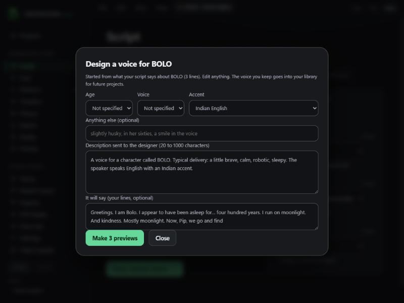
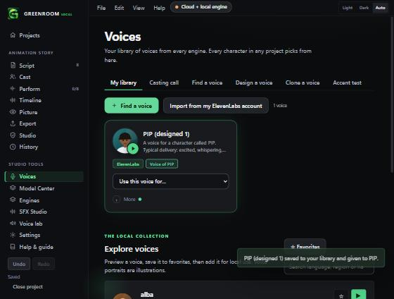

# Design a voice from the Script screen (v0.2.7)

On the **Script** screen, each character card on the right has a **Design a voice for NAME** button. It opens a small designer that starts from what your script already says about that character.

## How it works
1. Greenroom writes a starting description from the character's name and the delivery words in the script (for example `(gruff)` or `(whispering)`). Sounds such as laughs and gasps are left out.
2. You can choose **Age**, **Voice** (feminine, masculine, neutral) and **Accent**, add your own words, or edit the description directly. Age and voice type are never guessed from a name: they appear only if you choose them.
3. **Make 3 previews** asks first (ElevenLabs credits, like Voices, Design a voice), then plays three options. If the character's lines are long enough, the designer says them.
4. **Use for NAME** saves the voice to your **library** (so any future project can use it) and gives it to that character. It is saved with a "designed from a description, no real person" consent record, like other designed voices.

Every preview is also kept in the Local Design Vault on this computer, even if you do not save it.

## Honest limits
- **Voice design uses ElevenLabs, which is paid.** A free on-this-PC designer is not available yet (the Qwen3-TTS VoiceDesign model is in the catalogue but its runtime is not wired in).
- **Accents are not guaranteed.** The accent line tells the designer what to aim for; listen to all three previews.
- Saving a voice to your ElevenLabs account needs a plan that allows it. If not, the app says so and the preview stays in the vault.

## Checked
- Unit tests (9): delivery words ranked and sound cues excluded, correct wording, no guessing of age or gender, chosen age and voice type only, accent sentence, narrator as storyteller, the 20 to 1000 character limit, a spoken sample only when the lines are long enough, and cutting at a sentence end.
- Browser demo: the description is built from the script; choosing age and voice type updates it; the price sheet appears; three previews play; Use for PIP saves the voice, closes the dialog, selects it for PIP, and it appears in Voices, My library.

## Not checked
- A real ElevenLabs design or save from this dialog (the demo uses stand-in audio). It calls the same two backend commands as Voices, Design a voice, which were tested with a fake server, but never with a real paid call.
- Narrow window layout of the dialog.
