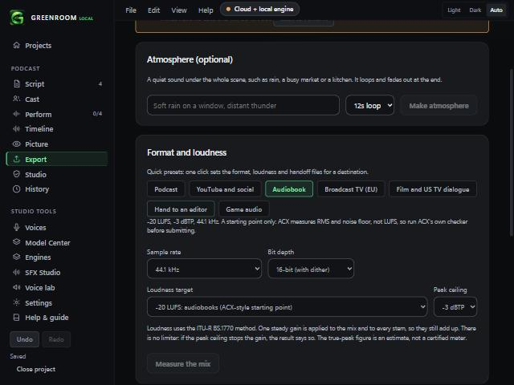

# Export presets (v0.2.4)

Export screen, **Format and loudness**. One click sets the sample rate, bit depth, loudness target, peak ceiling and handoff files for a destination.

| Preset | Sets |
|---|---|
| Podcast | -16 LUFS, -1 dBTP, 44.1 kHz, 24-bit |
| YouTube and social | -14 LUFS, -1 dBTP, 48 kHz, 24-bit |
| Audiobook | -20 LUFS, -3 dBTP, 44.1 kHz, 16-bit, a file per scene |
| Broadcast TV (EU) | -23 LUFS (EBU R128), -1 dBTP, 48 kHz, 24-bit, stems |
| Film and US TV dialogue | -24 LKFS (ATSC A/85), -2 dBTP, 48 kHz, 24-bit, stems, OTIO, EDL, cue sheet |
| Hand to an editor | 48 kHz, 24-bit, level untouched, every line, stems, markers, OTIO, EDL, cue sheet |
| Game audio | -16 LUFS, -1 dBTP, 48 kHz, 24-bit, a file per line |

The preset that matches your current settings is highlighted with its note underneath. Changing any setting by hand simply stops the highlight.

## Checked
- Unit tests: every preset uses only targets, rates, bit depths and ceilings the screen offers; applying one leaves unrelated settings alone; matching works; the audiobook note says it is not ACX certification.
- Browser demo: the seven chips render, and pressing Audiobook sets 44.1 kHz, 16-bit, the new -20 LUFS target and -3 dBTP.

## Not checked
- **Targets are commonly published numbers as of 2026-11-02, not verified against each platform today.** Platforms change them. Check the destination's current spec.
- **Audiobook is a starting point only.** ACX measures RMS and noise floor, not LUFS. Use ACX's own checker before submitting.
- No real export was run with a preset in the installed app.
