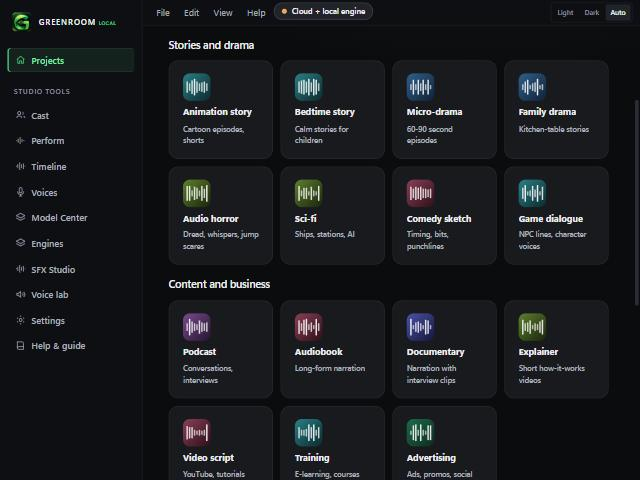
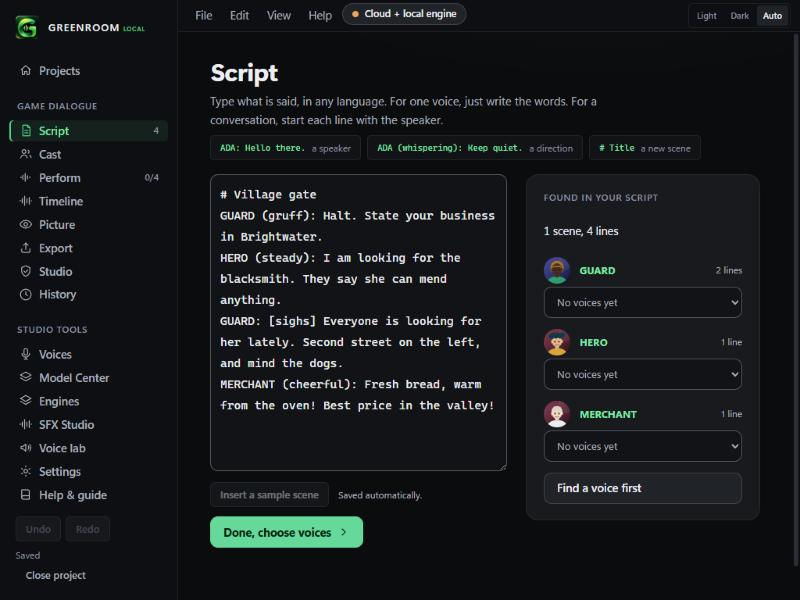
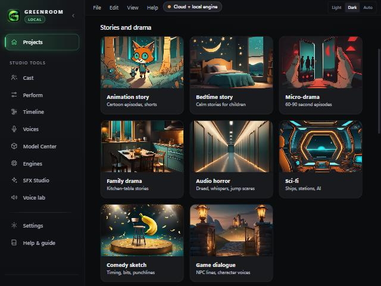

# Home templates and the engine chip (v0.2.3)

Learned from the Vois Studio review: a first screen that offers a start, and a header that says whether you can make speech right now.

## Start from a template
The Projects screen shows fifteen starting points in two groups.

- **Stories and drama:** Animation story (two scenes, narrator, a fox and a robot), Bedtime story, Micro-drama (a 60-90 second episode with a hook, a twist and a cliffhanger), Family drama, Audio horror, Sci-fi, Comedy sketch, Game dialogue.
- **Content and business:** Podcast, Audiobook, Documentary, Explainer, Video script, Training, Advertising.

Each card shows its picture (`app/public/templates/<id>.webp`, generated and credited in [TEMPLATE_ART_CREDITS.md](TEMPLATE_ART_CREDITS.md)), or generated card artwork if a picture is missing. Prompts for all fifteen pictures are in [TEMPLATE_ART_PROMPTS.md](TEMPLATE_ART_PROMPTS.md); a test checks every template is listed there.

Pressing one creates a project named after the template (or after what you typed in the name box) with a short script already written, its characters found, and you land on the Script screen. Edit it like any other script.

The scripts use the normal `NAME (direction): line` format, so everything downstream (Cast, Perform, Timeline, Export) works unchanged.

## Engine chip (top bar)
A small pill next to the Light, Dark and Auto buttons says what you can do right now. Pressing it opens Model Center.

| Chip | Meaning |
|---|---|
| Offline ready | A local engine is installed and you have a local voice in your library. |
| Local + cloud | The same, plus a cloud key is saved. |
| Engine ready | A local engine is installed but no local voice is in your library yet. |
| Cloud voices | Only cloud keys are saved. |
| Set up voices | Nothing is ready yet. |

## What was checked
- Unit tests: every template parses into at least two lines, one scene and one character; the animation starter has two scenes and PIP, BOLO and NARRATOR; dialogue templates have two or more speakers; every template appears in the art prompt guide; the chip's states.
- Browser demo: fifteen template cards render in two groups, with the badge fallback while no pictures exist; earlier, six cards rendered, pressing Game dialogue creates a project with 3 characters and 4 lines in 1 scene.

## Not checked
- Saving and reopening a template project in the installed app (it uses the same save path as a new project).
- The chip against a real Piper, Chatterbox or Wazobia install. In the demo it only shows the demo backend's state.
- Narrow window layout beyond the pane size used here.

- The story scripts are short starters written by Claude. Read them, especially the family drama, before you rely on their tone or cultural details.

