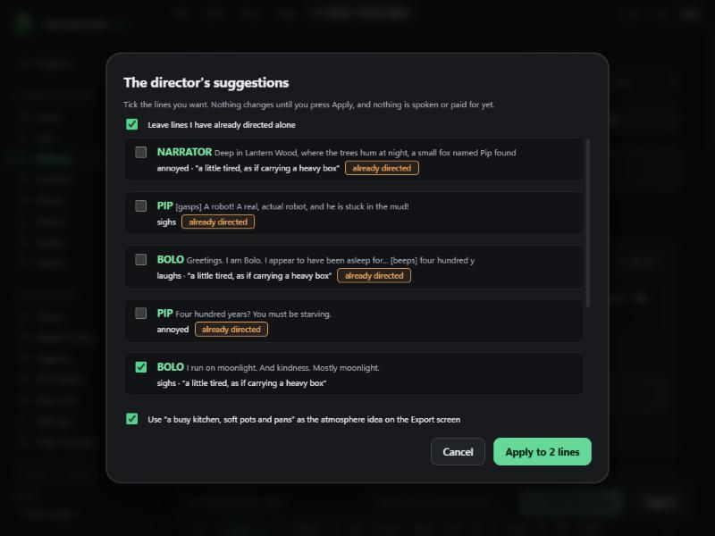

# Local AI Director (v0.2.6)

The Director reads your script and suggests an emotion, sounds and a short direction note for each line, plus an atmosphere idea. It only suggests: you review everything before anything changes.

Until now it needed a Kie key and sent your script to the cloud. It can now run on your PC: free, private, no account.

## Set up (Model Center, AI Director)
Press **Install local Director** on the "Local AI Director" card. One confirmation sheet, then Greenroom downloads:
- the llama.cpp engine, Windows Vulkan build b12052 (38 MB, MIT), checksum-verified, and
- the Qwen3 4B Instruct 2507 model, Q4_K_M (2.5 GB, Apache-2.0), checksum-verified and resumable.

It then selects the local Director for you. Change it any time in **Engines, AI Director, Director engine** (Kie cloud, or Local Director on this PC). The default for existing projects stays Kie.

## Use
**Perform, Direct with AI.** With the local engine there is no spend sheet (nothing is billed); the review dialog opens as before.

Privacy and resources: the engine listens only on `127.0.0.1` with a random per-launch secret, starts when first used, stops after five idle minutes and when Greenroom closes, so it does not hold your graphics card. Scripts over about 20,000 characters are refused with a message to try one scene at a time.

## What was tested on a real machine (RTX 3060 12 GB, Windows 11, 2026-11-02)
The app's real director prompt and its real safe parser were run against the real model through the real llama.cpp server (Vulkan, all layers on the GPU):

| Template | Lines directed | Time | Tokens |
|---|---|---|---|
| Animation story | 8 of 8 | 7.1 s | 547 |
| Micro-drama | 8 of 8 | 6.7 s | 536 |
| Audio horror | 7 of 7 | 6.5 s | 516 |

Every answer parsed. Example notes: PIP "bright and full of wonder" with a gasp; BOLO "robotic and slightly slow, with a dreamy tone"; the horror guard "quiet, tense, as if holding his breath". The model file's SHA-256 matched the published one.

Rust tests cover the pinned engine and model, loopback-only arguments with a secret, key generation, size limits, a missing engine, and safe shutdown.

## Not checked (say so to users)
- **Quality judgement.** The notes look sensible to the developer but only a director's ear can say if they are good. In one micro-drama line the model missed a bitter laugh that the script marked.
- **Click-through in the installed app**, including the 2.5 GB download and the first model load on a cold disk (the app waits up to 3 minutes for it).
- **Non-English scripts**, scripts longer than the limit, and **PCs without a usable graphics driver** (the engine falls back to the processor, which was not tested and will be slower).
- AMD and Intel graphics: the Vulkan build supports them, but only NVIDIA was tested.
