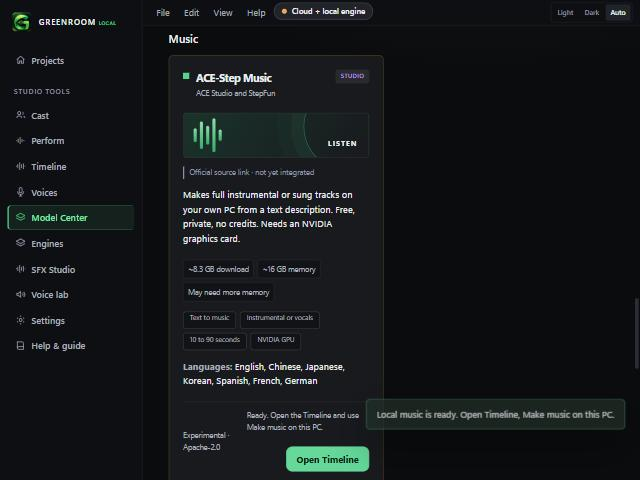
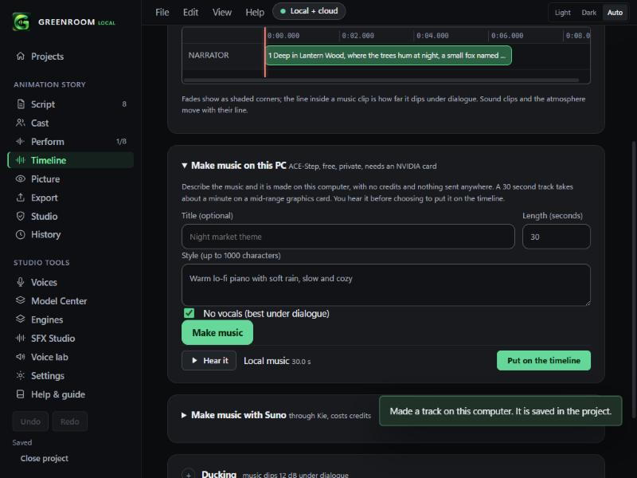

# Local music with ACE-Step (v0.2.4)

Make music on your own PC: free, private, no credits, works offline once installed.

## Set up (Model Center, Music)

One button, **Install local music**. After one confirmation sheet it:
1. installs the GPU music engine (about 3 GB: Python, CUDA PyTorch and ACE-Step), then
2. downloads the ACE-Step v1 3.5B model (8.3 GB, 12 files, each checked against a pinned SHA-256).

Needs **Windows x64 and an NVIDIA graphics card with at least 8 GB of video memory**. Without an NVIDIA card the card says so and installs nothing.

## Make music (Timeline, Make music on this PC)

Describe the music, choose 10 to 90 seconds, press **Make music**, listen, then **Put on the timeline**. The card appears once the project has takes (same place as the Suno card). Vocals are optional: untick "No vocals" and add lyrics. Every track is kept in the project as a take that is never overwritten, with a source note for the production report.

## What was tested on a real machine (RTX 3060 12 GB, 32 GB RAM, Windows 11, 2026-11-02)
| Test | Result |
|---|---|
| CUDA PyTorch 2.6.0 (cu124) in the app's embedded Python 3.11.9 | Works, `cuda.is_available()` true |
| ACE-Step installed from the pinned GitHub archive (commit `1bee4c9`) | Works with the app's exact pip steps |
| 20 s instrumental, 27 steps | 25 s, 6.7 GB peak video memory |
| 30 s instrumental through the app's own worker script, offline mode | 51 s including model load; valid 48 kHz stereo WAV, 29.9 s, not silent |

The PyPI package `ace-step` cannot be installed on Windows (its source archive is missing `requirements.txt`), which is why the engine is installed from the pinned GitHub archive instead.

## Unit tests
Rust: request limits (10 to 90 s, style 1 to 1000 characters, lyrics up to 2000), the pinned manifest (12 files, 8.3 GB, every checksum 64 hex characters), a missing engine reported without starting a process, and download names limited to one safe sub-folder. TypeScript: the same limits on screen, the setup states, the source note.

## Not checked (say so to users)
- **How the music sounds.** Only listening can say. Two test clips were made; judge them yourself.
- **A click-through in the installed app.** The engine install and the worker were replayed outside the app with the same commands, not run from the Install button. The first real install may show a difference.
- **Vocals and lyrics**, tracks over 30 seconds (the 90 second cap is untested), and **8 GB cards** (only a 12 GB card was available; the worker uses CPU offload to save memory).
- **Archive stability:** the engine is installed from a GitHub archive pinned by commit. The commit is fixed, but GitHub does not guarantee the archive bytes never change.
- **Licence:** the model card says Apache-2.0. Read it before commercial use, and check it for generated-music terms.
- Local SFX is not part of this: it needs a separate runtime (see the roadmap).
