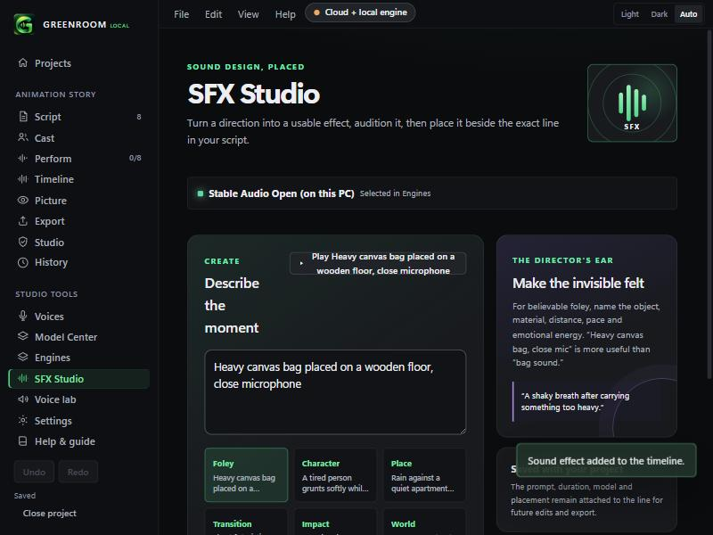

# Local sound effects with Stable Audio Open Small (v0.2.5)

Make sound effects on your own PC from a text description: free, no credits, works offline once installed.

## Set up (Model Center, Music)
The **Stable Audio Open Small** card uses the same golden path as WazobiaVoice:
1. Save a Hugging Face read token.
2. Open the model page and accept its terms (free, once). The model is gated.
3. Press **Install local sound effects**. One confirmation sheet, then Greenroom installs the engine (about 3 GB), the model (1.7 GB) and its text encoder (0.9 GB, no account needed). Every file is checked.

Then pick **Stable Audio Open (on this PC)** as the Sound engine in Engines. SFX Studio, sound clips in Perform and the atmosphere then use it: free, no confirmation sheet, up to 11 seconds each.

## Licence
Stability AI Community License: free for individuals and organisations below its revenue limit, with conditions. Read it before commercial use. The text encoder (T5-base) is Apache-2.0. Other free sound-effect models were rejected because they are non-commercial (AudioLDM2, TangoFlux, AudioGen, MMAudio).

## What was tested on a real machine (RTX 3060, Windows 11, 2026-11-02)
| Test | Result |
|---|---|
| Python 3.10.11 embeddable + CUDA PyTorch 2.7.1 (cu126) + stable-audio-tools 0.0.20, the app's exact pip steps | Installs; CUDA available |
| The app's real worker script (`runtime/sfx_once.py`) with a **random-weight stand-in** model and the real T5-base encoder | Runs end to end, offline: 3.0 s stereo 44.1 kHz WAV, both with the library's default sampler and with `pingpong` (the real model's sampler) |

### Three bugs this testing found and fixed before release
1. NumPy 2 broke the pinned PyWavelets at import. The installer now pins `numpy<2`.
2. The package needs `pytorch_lightning` when a model is created, though it lists it only as an optional extra. Now installed.
3. The library's default random seed overflows NumPy 1.x on Windows. The worker now passes an explicit seed.

The engine's own health check missed the first two, so it now imports everything the worker needs and requires NumPy below 2.

## Not checked (say so to users)
- **A real sound from the real model.** The weights are gated, so this build was never run with them. The worker was written from the library's documented usage and tested only with random weights, so the first real run may show a difference (for example in the model's config keys). Random weights make noise, so nothing was said about quality.
- **A click-through in the installed app**, including the gated download with a real token.
- **CPU-only PCs.** The worker falls back to the processor but this was not tested.
- **The 11 second limit** comes from the model's published length, not from a test. The atmosphere on this engine is capped at 11 seconds.
- Whether the sounds are good. Only listening can say.
