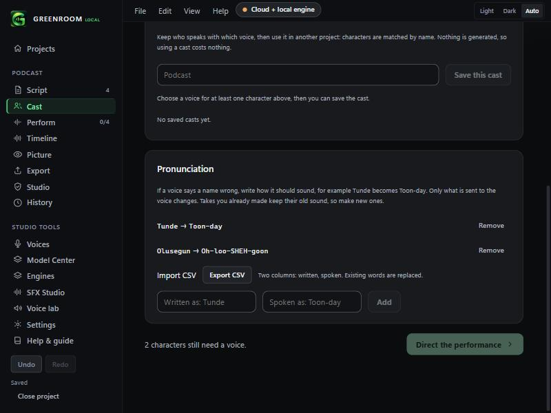

# Pronunciation CSV import and export (v0.2.4)

Cast screen, **Pronunciation**. Bring in a whole lexicon at once, or take yours to another project.

- **Import CSV** reads two columns: *written*, *spoken*. A header row (`written,spoken`) is skipped. Commas, tabs or semicolons separate columns, and quoted cells work (`"Smith, J.",Smith`).
- A word already in the list (any capitalisation) is **replaced** by the imported one.
- Bad rows are counted and skipped, not fatal. Files over 1 MB, or more than 2,000 rows, are refused or cut, and the message says so.
- **Export CSV** saves `pronunciations.csv`, which imports back unchanged.

## Checked
- Unit tests: header skipping, quotes, tabs, semicolons, BOM, Windows line endings, bad rows, a 2,000-row cap, case-insensitive merge, and a round trip.
- Browser demo: importing a two-row file adds both rules and shows "2 pronunciations imported."

## Not checked
- Excel-saved CSVs in a non-UTF-8 code page (accented names may appear wrong; save as CSV UTF-8).
- Export download in the installed Tauri app (it uses the browser download path; the file location was not confirmed).
