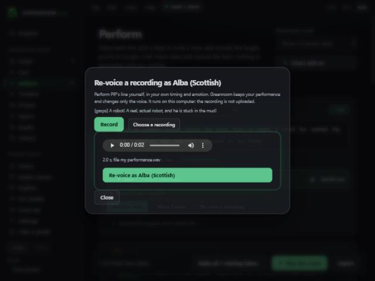

# Speech to speech: perform a line, hear it in a character's voice (v0.2.8)

Perform screen, on any line with a voice: **Re-voice a recording**.

1. Press **Record** and speak the line your own way (or **Choose a recording**: WAV, MP3, FLAC, OGG, up to about 5 minutes).
2. Listen to it, then press **Re-voice as NAME**.
3. After about a minute on most PCs, the result appears as a new take on that line and is selected.

Your timing, pauses and emotion are kept. Only the voice changes. It runs on this computer with Chatterbox voice conversion (MIT): the recording is not uploaded. The target voice is a few seconds of the character's own voice, made the usual way (free for local voices; cloud voices ask first, like any sample).

The take records that **a real person performed the line**, with the source (recorded here, or the file name), so the production report can tell it from text-to-speech.

Needs the Chatterbox engine and model installed in Model Center. The dialog says so, with a link, if they are not.

## Tested on a real machine (Windows 11, CPU runtime, 2026-11-02)
The app's exact Chatterbox install was replayed (embedded Python 3.11, CPU PyTorch 2.6.0, `chatterbox-tts` 0.1.7), then the app's real worker script (`runtime/chatterbox_vc_once.py`) converted a recording with the real model files (checksum-verified `s3gen.pt`, `conds.pt`).

| | Result |
|---|---|
| Source: male Windows voice, 8.09 s | median pitch 94.5 Hz |
| Target: female Windows voice, 13.3 s | median pitch 180.5 Hz |
| **Converted** | **8.08 s** (timing kept to 0.01 s), median pitch **148.8 Hz**, moving toward the target |
| Time | 36 s including model load, on the processor |

Three clips from that test are in a Desktop folder, "Voice conversion test", so you can judge by ear. Pitch moving toward the target is a measurement, not a verdict on quality.

### A real bug this found, and fixed
The app's existing **Chatterbox install never added `setuptools`**, which Chatterbox's watermarker needs. Without it, Chatterbox speech (and this feature) fails at startup with "NoneType is not callable". The installer now adds it, and the engine's health check requires the watermarker to load, so existing installs show as "not installed" until you press Install again.

## Unit tests
Rust: file types are an allow-list; recording and sample size limits are checked before anything starts; a missing Chatterbox is reported without starting a process; the health check requires the watermarker. TypeScript: recording length limits, sample file types, and the take's record that a person performed it.

## Not checked (say so to users)
- **How it sounds.** Only listening can say. It is a converter, not a mimic: it keeps your delivery, but accent and character come from the target voice, and it can sound rough on noisy or very quiet recordings.
- **Microphone recording in the installed app.** The demo used a chosen file. Recording needs Windows microphone permission for the app.
- **Click-through in the installed app**, and the GPU: this was tested on the processor. A faster run on graphics cards was not tried.
- **Non-English and singing**, very long recordings (over a minute), and noisy rooms.
- Cloud voices as targets (they need a sample made first, which can cost credits).
