# UI and UX pass (v0.2.9)

Every screen was opened in the demo with real data and checked at 1280, 900 and 560 px wide, in dark and light, with the default graphite surface. Forms and buttons were inconsistent: labels sat 4 px above their fields, button heights ranged over six sizes, the browser's raw "Choose File" control showed through, checkbox lists had hints jammed onto the same line, and some screens broke at narrow widths.

One shared layer, `app/src/styles/polish.css`, now sets the rules for forms, buttons, spacing and dialogs. It uses only the colour tokens, so it follows the accent, the surface choice and the light theme.

## What changed
- **Forms:** 8 px between a label and its control, one control height (40 px) and radius, a proper select arrow, readable placeholders, 18 px checkboxes where the whole row is clickable, and hints on their own line under each option.
- **File pickers:** the native control became a tidy drop-zone with a styled button.
- **Buttons:** one size scale (40 px, and 32 px for small), so rows and toolbars line up. A disabled primary button now looks clearly unavailable instead of a muddy green.
- **Cards and dialogs:** more padding, even spacing between sections, dialogs with room around their content.
- **Model Center:** each card's licence note sits above its buttons, instead of squeezing them side by side.
- **Narrow windows:** two-column screens (the Script editor and its side panel) stack instead of squeezing the editor to a sliver. No screen scrolls sideways at 900 or 560 px.
- **Perform:** words in a line sit closer together; the floating bar no longer says "Make all 0 missing takes".
- **Surfaces:** backgrounds that were fixed to a green-tinted black now follow the chosen surface.

## Before and after
| | Before | After |
|---|---|---|
| Design a voice | 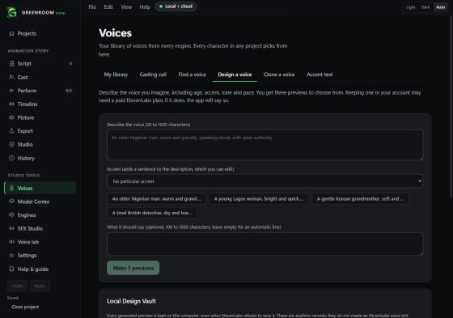 | 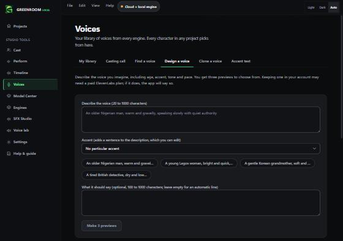 |
| Clone a voice | 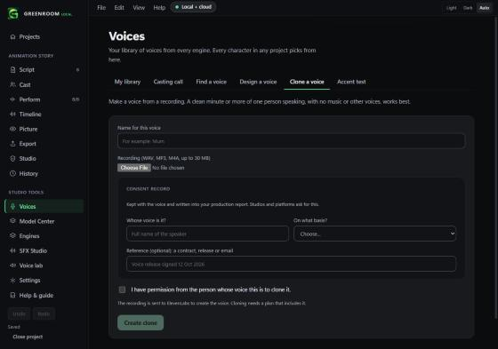 | 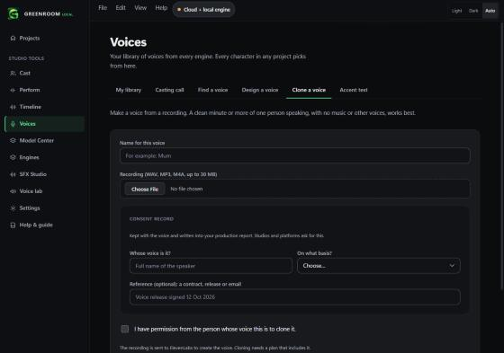 |
| Export, what to save | 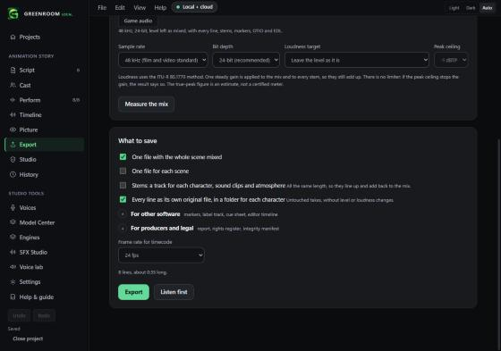 | 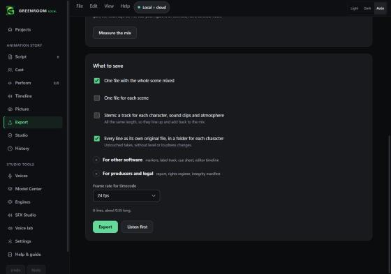 |
| Model Center | 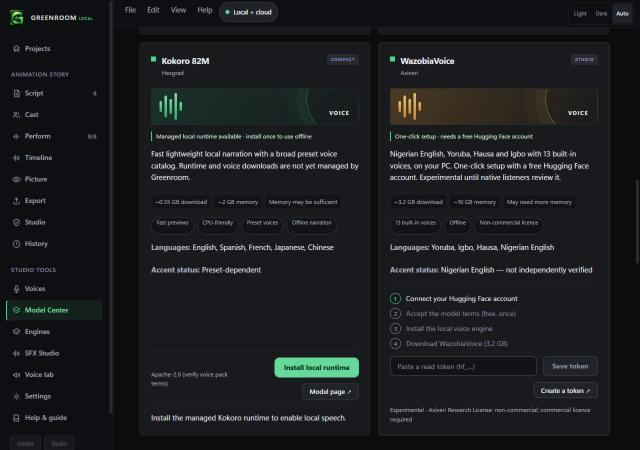 | 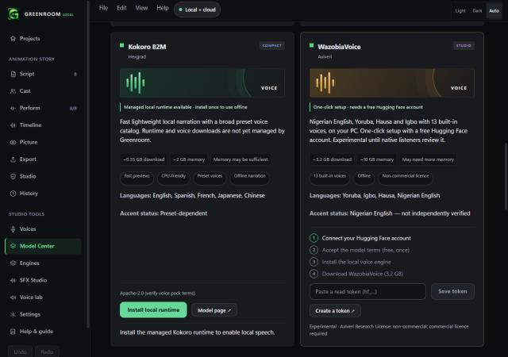 |
| Script at phone width | 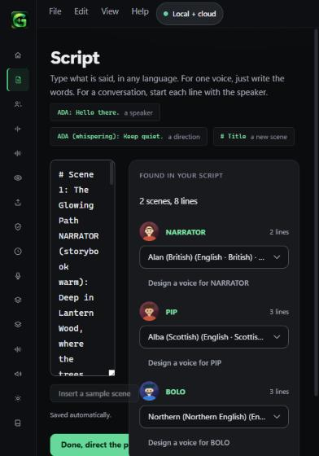 | 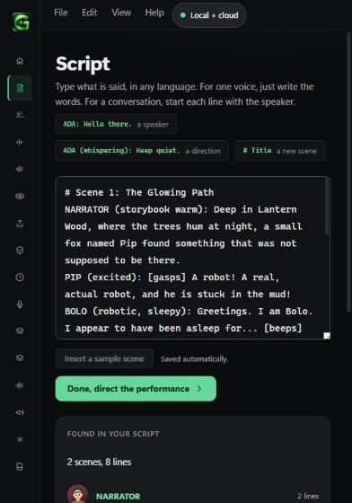 |

Light theme: 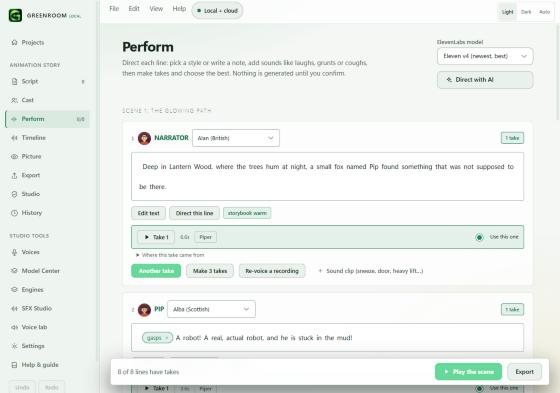

## Checked
- A visual walk through all 15 screens, the Design, Clone and Re-voice dialogs and the confirmation sheet.
- A programmatic check on every screen at 1280, 900 and 560 px: no horizontal scrolling anywhere after the fixes (it found one: the Script screen).
- 6 new tests guard the design system: the polish layer loads last, shared control tokens exist, the file picker and disabled-button rules exist, narrow windows stack, no justified text, no fixed green-black backgrounds. All 257 tests pass.

## Not checked
- A full keyboard and screen-reader audit. Focus rings are unchanged and visible; this pass did not test tab order or screen-reader announcements.
- The amber, azure, violet and coral accents on every screen, and the old green-tinted surface option, were not re-checked after this pass.
- Windows high-contrast mode, and window sizes under 560 px.
- Some screens still use their own layout CSS (for example SFX Studio and the Voice lab). They look consistent now, but they have not been rewritten onto the shared rules.

## Cards (second pass, same version)
Cards felt cluttered: a Model Center card stacked an art box, a status line, a paragraph, three rows of chips, languages, accent status and a licence, and a voice card carried two bordered chips, a heavy full-width button and a loud amber dot. Every card now follows one hierarchy: **picture, name, one line, one meta line, status, then actions**, with detail folded away.

- **Generated artwork** (`cardArt.tsx`): every card gets its own gradient, soft glows, fine rings and a waveform, in one of three styles (bold bars, fine lines, flowing curves). Each kind has its own colour family (voices teal to violet, music magenta to amber, sound blue to cyan, Director gold, stories violet to pink), so a glance says what a card is. The same seed always gives the same picture. Pictures you add for templates (`docs/TEMPLATE_ART_PROMPTS.md`) replace it.
- **Model Center:** the artwork leads, with the tier and an "Experimental" flag laid over it. The description is one sentence; size and memory are one quiet line; the full text, chips, languages, accent status and licence sit under **Details**. One bright primary button, with the rest quiet.
- **Voice cards:** the engine is a single tinted label next to a plain "English, Nigerian" line. "Open a project to use this voice" is a quiet link instead of a heavy bar. "Review rights" is a small amber dot with text, not a boxed pill.
- **Template cards:** a large artwork tile on top, the title and one line below, with a gentle zoom on hover.
- Cards lift slightly on hover (switched off for people who prefer reduced motion).

| | Before | After |
|---|---|---|
| Model Center |  | 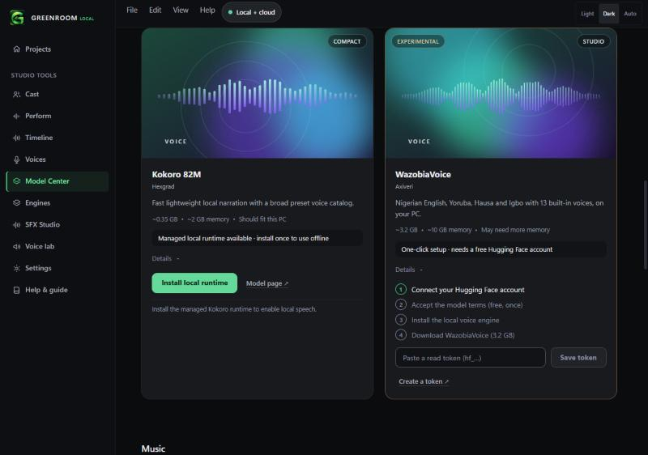 |
| Templates | 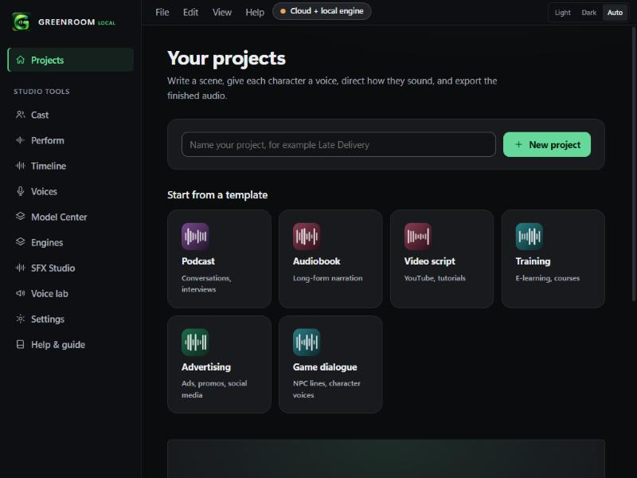 | 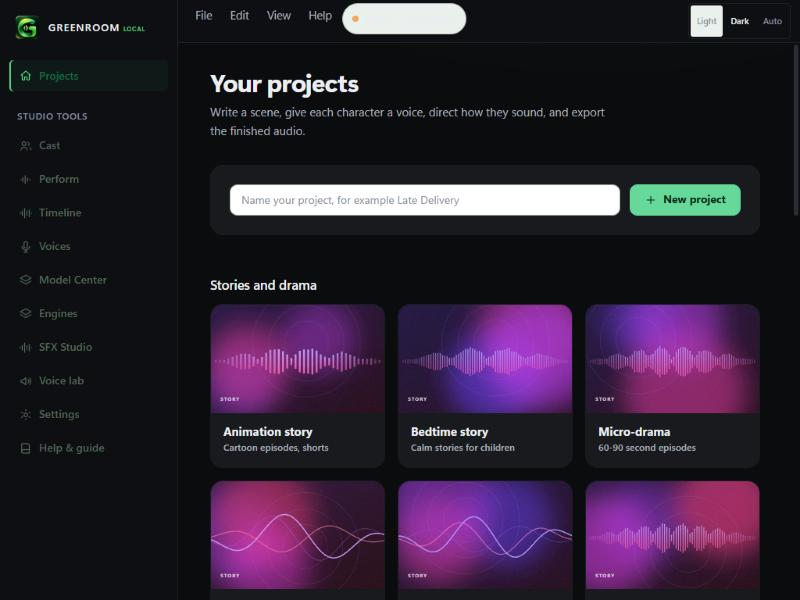 |
| Voice cards | | 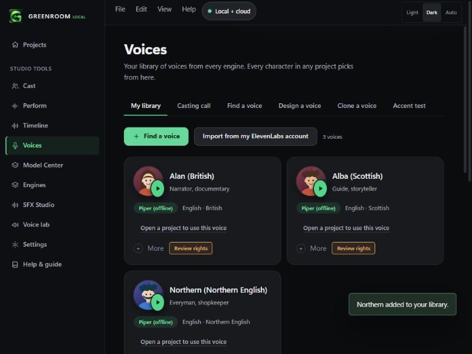 |

Checked: all three card types in dark and light, at 1280 and 560 px (no sideways scrolling); 8 new tests (artwork is deterministic, differs by seed and kind, stays within its colour family, uses all three styles; the card helpers); all 265 tests pass.
Not checked: every one of the 20 model cards and 15 templates individually; how the artwork looks with the amber, azure, violet and coral accents (the art uses its own colours, so it should not change); a screen reader reading the card Details control.

## Sidebar and voice cards (v0.3.0)
Prompted by two aspirational mockups: a sidebar with more presence, and a voice card with a stronger hierarchy.

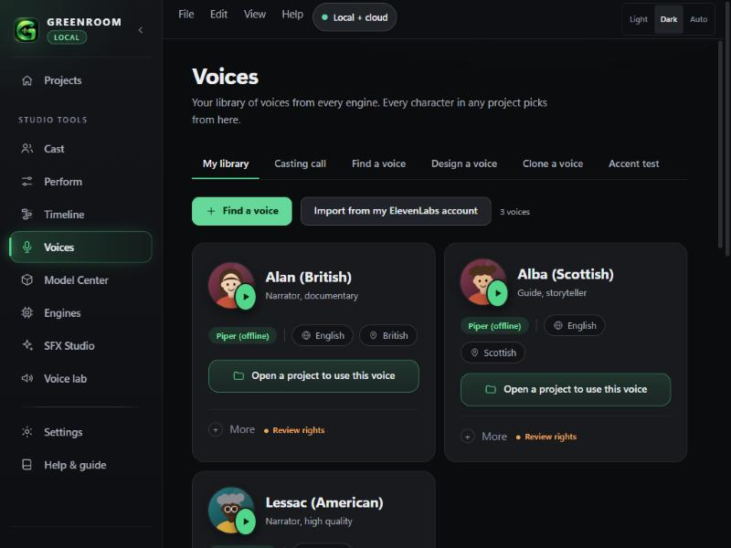

**Sidebar**
- A glassy panel with a soft accent glow at the top, a roomier brand block with the LOCAL pill, and group labels in small caps.
- The active item has a glowing accent bar, a gradient wash and a subtle halo. Hover is a gentle tint. Counts are small pills.
- A divider sits before Settings and Help.
- **Every item has its own icon.** Perform, Timeline, SFX Studio, Model Center and Engines used to share two icons; they now have Direct (sliders), Timeline (clips on tracks), Sparkle, Cube and Chip. A test guards this.
- The chevron next to the brand now **collapses the sidebar to icons** (remembered between launches). It also collapses by itself on narrow windows.

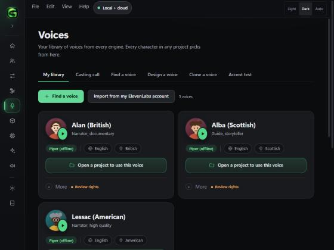

**Voice card**
- Large illustrated portrait with the play button, then the name (up to two lines, so nothing is cut), the tagline, and a small decorative waveform on wide cards.
- One row of chips with icons: the engine as a tinted label, then language (globe), accent (pin) and gender (person), shown only when known.
- One clear action: a full-width outlined accent button with a folder icon ("Open a project to use this voice"), or the "Use this voice for..." control when a project is open.
- A footer with a divider: "+ More" and a small amber "Review rights" when there is something to review.
- The glow now appears only for a voice already used in the project, and on hover, so a page of cards stays calm.

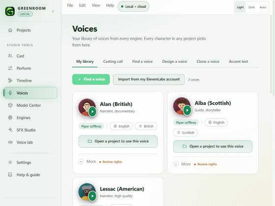

### Decisions that differ from the mockups
- **Illustrated portraits, not photographs.** A photograph implies a real person is the voice, which is misleading for designed and cloned voices, and Greenroom has no photos to use. A portrait you choose yourself could be added later.
- **The waveform is an ornament**, drawn from the voice's name, not a picture of its audio. It is hidden on narrow cards.
- **No glowing border on every card**, for the reason above.

### Checked
Dark, light and collapsed sidebar; no sideways scrolling on any of the 15 screens at 900 or 560 px; 4 new tests (voice chips; distinct sidebar icons; the layer order; no justified text). All 269 tests pass.
### Not checked
- Keyboard use of the collapse button and screen-reader announcements (it has an aria-label and reports expanded or collapsed).
- A very long voice name with a very long accent, which wraps but was not tried in every combination.
- The other accent colours on the new sidebar glow (it uses the accent token, so it should follow).

## Round play button, favorites and more (v0.3.1)
- **The oval play button is fixed at its cause.** A global `min-height: 40px` on every button overrode smaller fixed sizes, so the 32 px round play button became 32 by 40. Buttons are now sized with `height`, so any explicit size wins again (this also protects other fixed-size buttons, such as the word-gap markers on Perform). The play button is now a true 36 px circle, measured in the running app, and a test guards the rule.
- **Playing state:** while a voice plays, its button turns amber and pulses a soft ring (switched off for reduced motion).
- **Favorites on voice cards:** a star in each card's corner. Favorites float to the top of My library and a **Favorites** chip filters to them. Saved on this computer.
- **Tidier chips:** language, accent and gender chips are a little smaller so they sit together, and the engine label keeps its own tint. The "Open a project to use this voice" button wraps to two lines on narrow cards instead of being clipped.

Checked: play buttons measured at 36 by 36 on all cards; favoriting reorders the cards; 2 new tests (favorites first; button sizing rule); all 271 tests pass.
Not checked: the pulse ring on a real audio playback in the installed app (the demo plays stand-in audio).
