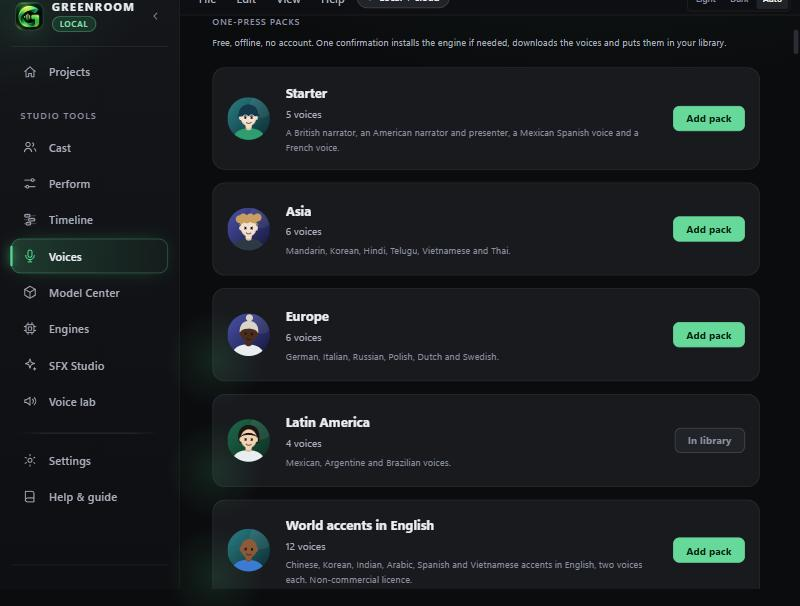

# Voice packs, accents and expressions (v0.4.0)

Three things for getting a varied cast with very little effort.

## 1. Menu fix
The File, Edit, View and Help menus used four independent `
` elements, so opening a second menu left the first one showing and the two overlapped. They are now one menu bar (`app/src/MenuBar.tsx`): only one menu is open at a time, it closes on an outside click, on Escape and when an item is chosen, Left and Right move between menus, and moving the pointer across the bar while one is open switches menus. The popup has an opaque background and sits above the page.

## 2. One-press voice packs (Voices, Casting call)
Five packs of free, offline Piper voices. Press **Add pack**, confirm once, and Greenroom installs the small Piper engine if needed, downloads each voice (checked against its published checksum) and adds all of them to your library.

| Pack | Voices |
|---|---|
| Starter | British and American narrators, an American presenter, Mexican Spanish, French |
| Asia | Mandarin, Korean, Hindi, Telugu, Vietnamese, Thai |
| Europe | German, Italian, Russian, Polish, Dutch, Swedish |
| Latin America | Mexican, Argentine and two Brazilian voices |
| World accents in English | Chinese, Korean, Indian, Arabic, Spanish and Vietnamese accents speaking English, two voices each |

The casting call now lists about 100 voices. New native voices: Mandarin (3), Hindi, Malayalam, Telugu, Urdu, Nepali, Persian, Turkish, Russian, Ukrainian, Polish, Italian, Dutch, Swedish, Greek, Vietnamese, Thai, Indonesian, Hebrew and more Mexican and Brazilian voices. Nigerian English, Yoruba, Hausa and Igbo are still the WazobiaVoice section (token and 3.2 GB setup in Model Center).

### Accents spoken in English
The **L2-ARCTIC** voice is one Piper file holding 24 non-native English speakers: four each for Arabic, Mandarin, Hindi, Korean, Spanish and Vietnamese backgrounds. Each is its own library entry (`en_US-l2arctic-medium@N`, N is the speaker number), so the file downloads once however many you add. Languages and genders come from the corpus documentation.

**Licence: CC BY-NC 4.0, non-commercial only.** The confirmation sheet says so and each card is marked. Use a design recipe or another voice for paid work.

### More accents to design (ElevenLabs, paid)
The accent list used by Design a voice and the accent listening sheet grew from 10 to 32: Chinese (Mandarin, Cantonese), Korean, Japanese, Indian (Hindi, Tamil, Bengali), Pakistani, Spanish, Mexican, French, German, Italian, Russian, Arabic, Turkish, Brazilian, Vietnamese, Thai, Kenyan, Irish and Australian, beside the earlier Nigerian, Ghanaian, Filipino, Jamaican, South African and Scottish. The listening sheet starts with the original ten ticked so its price does not jump. Eleven new casting-call recipes cover Mandarin, Korean, Japanese, Hindi, Spanish, French, Russian, Arabic, Brazilian, Kenyan and Hausa accents.

## 3. More human expressions (Perform)
Under **Sounds in the line**, a folded **More expressions** section adds 74 tags in six groups: laughter, crying and distress, breath, throat and mouth, reactions, and delivery (for example belly laugh, sob, voice cracks, deep breath, hum, hiccup, growl, stammer, under their breath, through gritted teeth). They are written into the line as `[tags]` like the core sounds. The AI director keeps using the shorter core list so a small local model is not overwhelmed.

## What was checked
- Unit tests: Piper voice keys (including `x_low` and `@speaker`), 24 unique accent speakers numbered 0 to 23, every pack key exists, accents and native languages covered, 30+ design accents, 60+ extra expression tags that are unique and bracket-free. Rust tests for speaker parsing (`a@7` accepted; `a@`, `a@x`, `../x@1`, `a@1@2` refused) and for `--speaker` in the Piper arguments.
- All Piper keys added were looked up in the public rhasspy/piper-voices catalogue on 2026-11-04, and the L2-ARCTIC speaker map was read from its published config.
- Browser demo: the packs render, the Latin America pack shows one sheet (4 voices, 4 downloads) and then reads In library; the menus open one at a time.

## Not checked
- **A real download, install and playback** of any pack in the installed app. The demo backend only pretends.
- **How convincing the accents are.** Nobody has listened and rated them. The L2-ARCTIC voices are real learners, so they sound like real accents, not caricatures, but quality varies by speaker.
- The gender labels of the accent speakers come from the corpus notes, not from listening.
- The 68 extra expression tags are untested on ElevenLabs. Piper, Kokoro and VoiceKiller ignore or reject tags.
- Whether the licence text on each non-L2 voice allows your use. Check each voice's model card.
