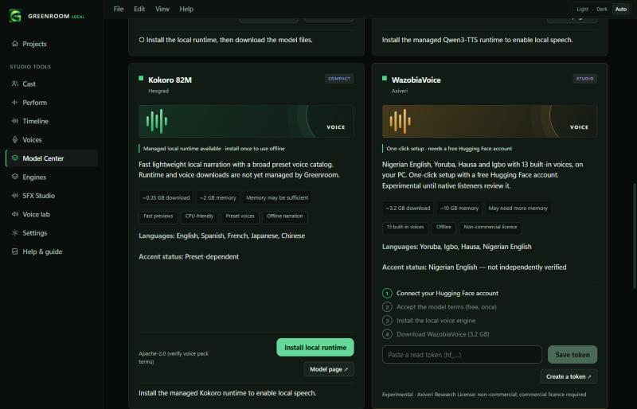
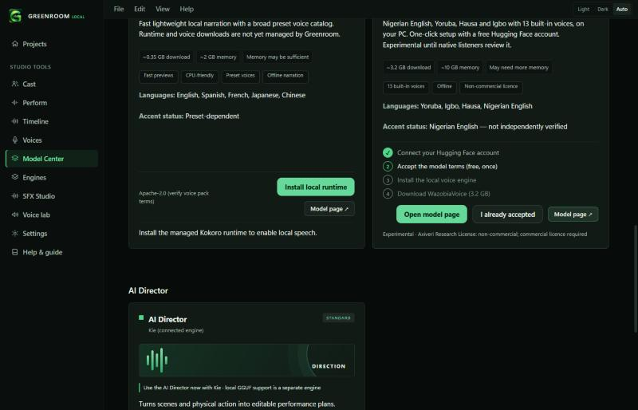
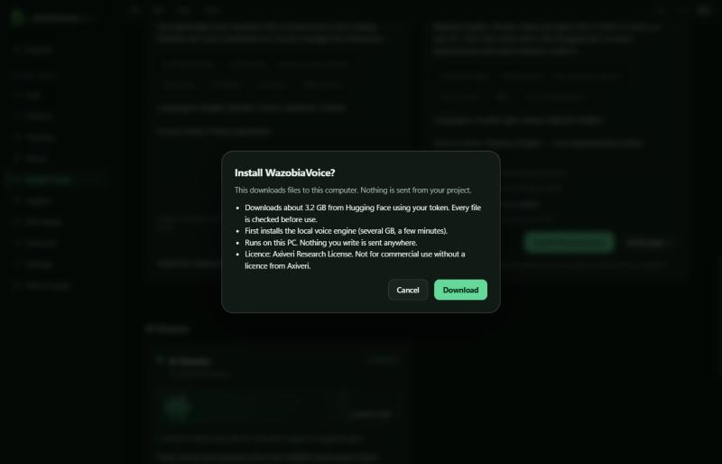
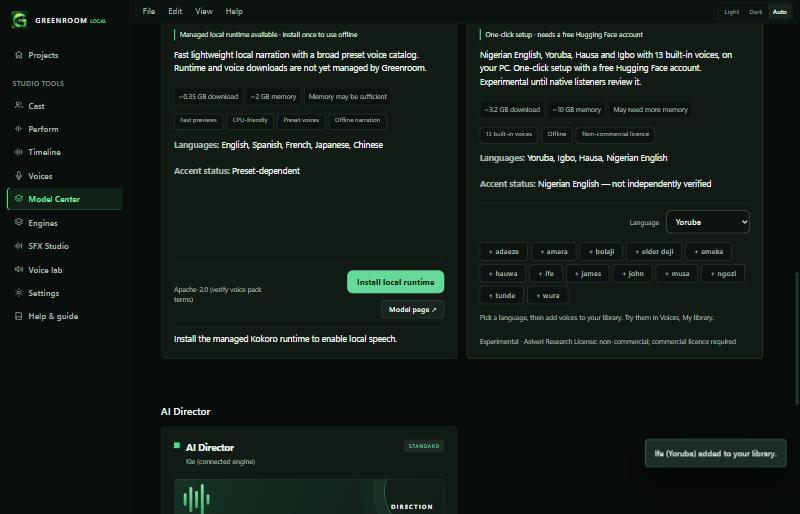

# Installing WazobiaVoice in one flow

Model Center, **WazobiaVoice** card. Nigerian English, Yoruba, Hausa and Igbo, with 13 built-in voices, running on this PC.

## Why it is not literally one click
WazobiaVoice is a *gated* model on Hugging Face. Two things only the person can do:

1. Create a free Hugging Face account and press **Agree and access repository** on the [model page](https://huggingface.co/Axiveri/WazobiaVoice).
2. Save a read token in Greenroom (stored in the Windows Credential Manager, never written to a file or log).

Everything else is automatic: Greenroom installs the local voice engine, downloads the files, checks them and adds the voices.

## The golden path
The card shows four steps and one primary button that always does the next one.

1. **Connect Hugging Face.** Paste a read token and press *Save token*. *Create a token* opens the right Hugging Face page.
2. **Accept the model terms.** *Open model page* opens it in your browser. Press *I already accepted* if you did this earlier.

3. **Install.** One confirmation sheet states the size (about 3.2 GB), the licence and that the engine is installed first if missing. Press *Download*.

4. **Add voices.** Choose a language, then press a voice to add it to *Voices, My library*. The same reference voice can be added in several languages.

## What is checked
- Files are pinned to one Hugging Face commit (`8ca840df`). Sizes are fixed in the app.
- The SHA-256 of each large file is read from that commit with your token (Hugging Face hides it from anonymous visitors), and every downloaded byte is checked against it. The two small text files are checked against their pinned git object ids.
- Downloads resume after an interruption. A failed or partial download never replaces a working install.
- The token is sent only to huggingface.co. It is dropped when Hugging Face redirects to its download servers.

## Licence
Axiveri Research License: non-commercial. Commercial use needs a licence from Axiveri. The card, the confirmation sheet and each voice's note say so.

## Not yet verified (be honest with users)
- **No real run.** Nobody has installed or run the model through this build. The download used a fake server in tests. The first real install may show a difference (for example a changed file list).
- **Speech path is a best guess.** Wazobia is a Chatterbox fine-tune whose weights are named like Chatterbox's v2 files, so Greenroom loads it with the Chatterbox runtime (`t3_model="v2"`) and the built-in voice as the reference clip. If the pinned `chatterbox-tts` release rejects the Yoruba, Hausa or Igbo language codes, speech will fail with a plain message. Check this first on a real machine.
- **Accent quality** is unrated. Only listening can promote it.
- Voice names are not mapped to languages or genders, because the model card is gated. Judge by ear.

## For developers
| Piece | Where |
|---|---|
| Gated, token-authenticated download | `app/src-tauri/src/model_manager.rs` (`install_gated`, `resolve_gated`) |
| Pinned manifest and speech | `app/src-tauri/src/lib.rs` (`wazobia_manifest`, `wazobia_speak`) |
| Step logic and voice entries | `app/src/wazobia.ts` (tested in `wazobia.test.ts`) |
| Card | `app/src/screens/WazobiaSetup.tsx` |
